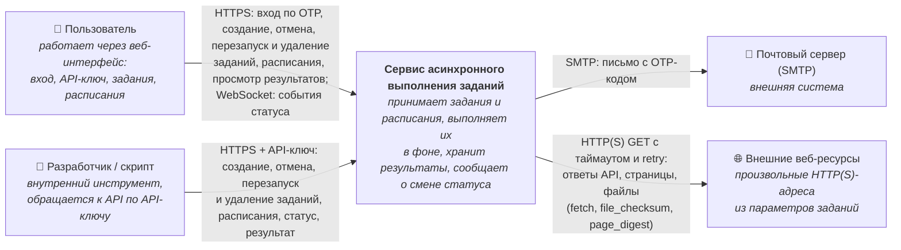
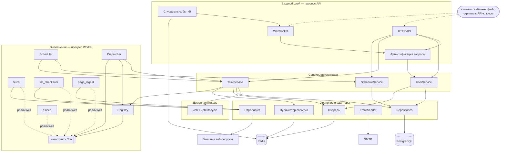

# Архитектура

Документ описывает сервис асинхронного выполнения заданий на двух уровнях: контекст (система целиком, её
пользователи и внешние системы) и компоненты (что внутри и как части связаны). Поведение системы задают
[README.md](../README.md) и [requirements.md](requirements.md).

Схемы написаны на Mermaid: исходник — сам текст в этом файле, GitHub отображает его как диаграмму.

## 1. Контекст системы (C4: Context)

**Что показывают стрелки:** вызовы во время работы. Стрелка идёт от того, кто начинает взаимодействие, к тому,
кто отвечает; подпись — протокол и содержание. Ответ (результат, статус) идёт по тому же соединению обратно
и отдельной стрелкой не рисуется. События статуса по WebSocket тоже идут по соединению, которое открыл
пользователь, поэтому стрелка направлена от пользователя.

| Участник | Роль |
|---|---|
| Пользователь | Входит по email и OTP-коду (токены в cookie), получает API-ключ, создаёт задания и расписания, отменяет, перезапускает и удаляет задания, следит за статусом в веб-интерфейсе. |
| Разработчик / скрипт | Создаёт задания, отменяет, перезапускает и удаляет их, управляет расписаниями, забирает результат через сетевой API, аутентифицируется API-ключом. Выпустить новый ключ по API-ключу нельзя — только после входа по OTP. |
| Почтовый сервер | Доставляет одноразовый код входа. Система только передаёт письмо и не отвечает за доставку. |
| Внешние веб-ресурсы | Источник данных для `fetch`, `file_checksum`, `page_digest`. Система не управляет ими: они могут не отвечать, отвечать медленно или отдавать некорректные данные. Недоступность одного URL в `fetch` — часть результата, а не сбой задания. |

PostgreSQL и Redis на этом уровне не показаны: это части нашей системы, а не внешние системы. Они появляются
на схеме компонентов.

## 2. Компоненты

Система работает в двух процессах:

- **API** — принимает HTTP- и WebSocket-запросы, отдаёт health check, пишет логи с correlation ID; слушает
  события статуса и пересылает их клиентам;
- **Worker** (ARQ) — выполняет задания через `Dispatcher`, отправляет письма с OTP и раз в минуту запускает
  планировщик расписаний.

Веб-интерфейс — отдельный клиент API.

**Что показывают стрелки:** зависимости кода. Сплошная стрелка `A → B` значит «A использует интерфейс B»;
B ничего не знает об A. Пунктир «реализует» — конкретный Tool реализует контракт `Tool`. Стрелки к PostgreSQL,
Redis, SMTP и внешним ресурсам — зависимость компонента от внешнего сервиса и библиотеки доступа к нему.
Пунктир от клиентов — сетевые вызовы, а не зависимость кода.

Вызовы во время работы на этой схеме не показаны: ARQ сам вызывает `Dispatcher`, `EmailSender` и `Scheduler`,
когда достаёт их задачи из Redis, но компонент «Очередь» от них не зависит. Слушатель событий передаёт
события в WebSocket, поэтому зависит от него, а не наоборот. Путь вызовов при выполнении задания описан
в разделе 3.

Главное, что видно по направлению стрелок:

- `Dispatcher` зависит от `Registry` и контракта `Tool`, но не от конкретных исполнителей. Новый Tool
  добавляется регистрацией, без правки `Dispatcher` и `TaskService`.
- Исполнители не зависят от `TaskService`, хранения и очереди: они не знают о статусах, повторах и источнике
  отмены (отмена приходит к ним как прерывание выполнения).
- Статус меняется только через `TaskService`, а тот — только через `JobLifecycle`. Поэтому проверка
  допустимых переходов одна для API (отмена, перезапуск), воркера (старт, завершение, сбой) и планировщика
  (создание). Состояния и переходы — в [job-lifecycle.md](job-lifecycle.md).
- В PostgreSQL ходят только репозитории, в Redis — только очередь, публикатор и слушатель событий,
  во внешнюю сеть — только `HttpAdapter`, в SMTP — только `EmailSender`.

### Ответственность компонентов

| Компонент | За что отвечает | Что скрывает от соседей |
|---|---|---|
| HTTP API | Принимает запросы `/api/...`, проверяет схему тела, читает ключ идемпотентности из заголовка, превращает ошибки сервисов в коды ответа (`401`, `404`, `409`, `422`, `500`, `503`) и единый формат ошибки; присваивает каждому запросу correlation ID (`X-Request-ID`). Контракт — [api/openapi.yaml](api/openapi.yaml). | HTTP от сервисов: cookie, заголовки, коды статусов, сериализацию JSON. |
| Аутентификация запроса | Определяет пользователя по JWT из cookie или по API-ключу из заголовка `X-API-Key`; выпускает и проверяет токены. Различает способ входа: выпуск API-ключа разрешён только при входе через cookie. | Подпись и срок жизни токенов, имена cookie, хранение API-ключа в виде хеша. |
| WebSocket | Отклоняет подключение без токена, держит соединение пользователя, отправляет ему события только его заданий; не пишет в закрытое соединение. | Жизненный цикл соединений: кто подключён, закрытые сокеты. |
| Слушатель событий | В процессе API подписан на канал `task_status_updates` и передаёт события в WebSocket. | Что события приходят из другого процесса через Redis Pub/Sub. |
| UserService | Регистрация, вход по OTP, проверка кода и срока его жизни, выпуск API-ключа. | Хранение OTP и то, что письмо уходит через очередь, а не отправляется сразу. |
| TaskService | Создание задания с проверкой параметров по схеме из `Registry` и ключу идемпотентности; список и получение только своих заданий; отмена и перезапуск (retry) после `failed`; удаление неактивных заданий; смена статуса через `JobLifecycle` с публикацией события; сохранение результата или ошибки. | Порядок «сохранить → поставить в очередь → опубликовать событие», механику идемпотентности ([ADR-0001](adr/0001-idempotency.md)), отмены, перезапуска и удаления ([ADR-0003](adr/0003-job-deletion.md)), проверку владельца. |
| ScheduleService | Создание, приостановка, возобновление, удаление расписаний (однократных и cron); расчёт следующего запуска. | Разбор cron-выражений и часовых поясов. |
| Scheduler | Раз в минуту находит наступившие активные расписания и создаёт по ним задания через `TaskService` с ключом идемпотентности «расписание + время срабатывания»; пропущенные запуски не догоняет. | Как найти наступившие запуски и не создать два задания на одно срабатывание. |
| Dispatcher | Получает задание из очереди, переводит `created` в `running` (после retry задание уже в `running`, статус не меняется), берёт Tool из `Registry`, запускает его, переводит в `finished` / `failed` / `cancelled`; при аварийном сбое решает, повторить попытку внутри `running` или фиксировать `failed`; результат задания, отменённого во время выполнения, отбрасывает. | От исполнителей — статусы, хранение, повторы и таймаут, источник сигнала отмены ([ADR-0002](adr/0002-background-worker.md)). |
| Registry | Соответствие «тип операции → Tool» и схема параметров каждого типа. | Набор конкретных исполнителей: ни `Dispatcher`, ни `TaskService` не перечисляют типы операций. |
| Tool (`asleep`, `fetch`, `file_checksum`, `page_digest`) | Выполняет одну операцию: получает проверенные параметры, возвращает результат или ошибку исполнителя ([tool-contract.md](tool-contract.md)). | Как именно выполняется операция: параллельность запросов, потоковое чтение файла с лимитом размера, разбор HTML. |
| Job + JobLifecycle | Статусы `created`, `running`, `finished`, `failed`, `cancelled`, действия `run`, `finish`, `fail`, `cancel`, `retry` и единственная таблица допустимых переходов ([job-lifecycle.md](job-lifecycle.md)). | Таблицу переходов: остальные просят «перевести в X» и получают отказ при недопустимом переходе (на уровне API — `409`). |
| Repositories | Чтение и запись пользователей, API-ключей, заданий с параметрами, результатом и ошибкой, расписаний; мягкое удаление заданий. | SQL, транзакции, схему таблиц и миграции, уникальность ключа идемпотентности в пределах пользователя ([ADR-0001](adr/0001-idempotency.md)), фильтрацию удалённых заданий во всех чтениях ([ADR-0003](adr/0003-job-deletion.md)). |
| Очередь | Постановка задания в очередь под его идентификатором и прерывание поставленного или выполняемого задания. | ARQ и Redis: подключение, формат сообщения, число попыток, служебные задачи ([ADR-0002](adr/0002-background-worker.md)). |
| Публикатор событий | Публикация события смены статуса. | Redis Pub/Sub: канал `task_status_updates`, формат сообщения. |
| EmailSender | Отправка письма с OTP-кодом. | SMTP-клиент, адрес сервера, учётные данные, шаблон письма. |
| HttpAdapter | Единая точка запросов во внешнюю сеть: таймаут, ограниченный retry, лимит размера ответа, разбор некорректного ответа. | HTTP-клиент, политику повторов и вид сетевых ошибок: наружу выходит один тип ошибки адаптера. |

## 3. Путь вызовов при выполнении задания

Порядок вызовов во время работы (не зависимости кода):

1. `POST /api/tasks` → аутентификация → `TaskService` → `Registry` (тип и параметры; ошибка → `422`) →
   `Repositories` (сохранить со статусом `created`; ключ идемпотентности уже есть → вернуть прежнее задание) →
   очередь → публикатор событий (`created`). Недоступна PostgreSQL или очередь — `503`, задание не сохраняется
   ([ADR-0002](adr/0002-background-worker.md)).
2. Воркер достаёт задание из очереди → `Dispatcher` → `TaskService` (`running`) → `JobLifecycle` →
   `Repositories` → публикатор событий.
3. `Dispatcher` → `Registry` (Tool по типу) → `Tool` → (для сетевых Tool) `HttpAdapter`.
4. Исход: результат → `finished` с сохранением результата; ошибка исполнителя или исчерпаны попытки →
   `failed` с сохранением причины; прерывание по отмене → `cancelled`. Каждый переход идёт через
   `TaskService` → `JobLifecycle` → `Repositories` → публикатор событий.
5. Redis Pub/Sub → слушатель событий в процессе API → WebSocket → клиент.

Отмена: `POST /api/tasks/{id}/cancel` → `TaskService` (проверка владельца; чужое задание → `404`) →
`JobLifecycle` (статус не `created` и не `running` → `409`) → `cancelled` в хранилище → прерывание в очереди. Если задание
ещё не начато, воркер его не запустит; если выполняется — Tool прерывается.

Перезапуск: `POST /api/tasks/{id}/retry` → `TaskService` (проверка владельца; чужое задание → `404`) →
`JobLifecycle` (статус не `failed` → `409`) → `running` в хранилище, прежняя ошибка очищается → очередь →
публикатор событий. Воркер выполняет задание с шага 3, не меняя статус.

Удаление: `DELETE /api/tasks/{id}` → `TaskService` (проверка владельца; чужое или уже удалённое задание →
`404`; статус `created` или `running` → `409`) → `Repositories` (отметка об удалении, статус не меняется) →
`204`. Это не переход статуса: `JobLifecycle` не участвует, событие не публикуется
(см. [job-lifecycle.md](job-lifecycle.md)).
