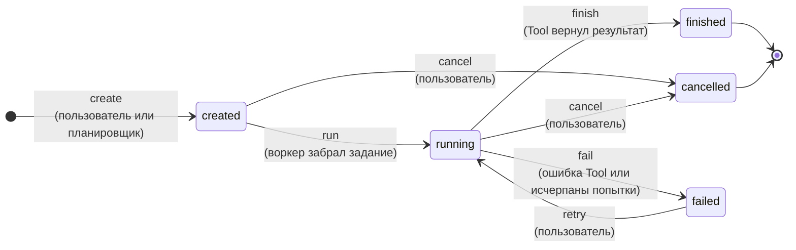

# Жизненный цикл Job

Диаграмма состояний задания (Job): все состояния, разрешённые переходы и ответ системы на попытку
запрещённого перехода. Проверку переходов выполняет один компонент — `JobLifecycle`
(см. [architecture.md](architecture.md)); остальные компоненты меняют статус только через него.

## Диаграмма состояний



Подписи на стрелках — действие и кто его выполняет. Переход в `created` происходит только при создании
задания: вернуть задание в `created` нельзя.

## Состояния

| Состояние | Смысл | Терминальное |
|---|---|---|
| `created` | Задание проверено, сохранено и поставлено в очередь, но воркер ещё не взял его в работу. | нет |
| `running` | Воркер выполняет задание: нашёл Tool по типу операции и запустил его. Сюда же задание попадает после `retry`, пока снова ждёт воркера в очереди. | нет |
| `finished` | Tool вернул результат, результат сохранён. Ошибки по отдельным URL в `fetch` — часть результата. | да |
| `failed` | Tool не смог выполнить операцию или воркер исчерпал попытки после аварийного завершения. Причина ошибки сохранена. Задание можно перезапустить через `retry`. | нет |
| `cancelled` | Пользователь отменил задание до начала или во время выполнения. | да |

## Разрешённые переходы

| Действие | Из | В | Кто инициирует | Что происходит |
|---|---|---|---|---|
| `create` | — | `created` | Пользователь (`POST /api/tasks`), планировщик по расписанию | Задание сохраняется и ставится в очередь. Повтор с тем же ключом идемпотентности возвращает существующее задание и перехода не создаёт. |
| `run` | `created` | `running` | Воркер (`Dispatcher`) | Воркер забрал задание из очереди и запускает Tool. |
| `finish` | `running` | `finished` | Воркер (`Dispatcher`) | Tool вернул результат; результат сохраняется. |
| `fail` | `running` | `failed` | Воркер (`Dispatcher`) | Tool отказал с ошибкой исполнителя или исчерпаны автоматические попытки ARQ; причина сохраняется. |
| `cancel` | `created`, `running` | `cancelled` | Пользователь (`POST /api/tasks/{id}/cancel`) | Из `created` — задание не будет запущено. Из `running` — Tool прерывается в ближайшей точке проверки отмены. |
| `retry` | `failed` | `running` | Пользователь (`POST /api/tasks/{id}/retry`) | Прежняя ошибка очищается, задание снова ставится в очередь; воркер выполняет его, не меняя статус. |

Автоматические повторы ARQ после аварийного завершения воркера (см. «Ошибка 3» в
[requirements.md](requirements.md)) происходят внутри состояния `running` и переходом не считаются. Переход
`fail` выполняется, только когда попытки исчерпаны. `retry` — это явное действие пользователя после `failed`.

Каждый переход публикуется в Redis Pub/Sub (канал `task_status_updates`) и при активном соединении
доставляется владельцу задания по WebSocket.

## Запрещённые переходы и ответ системы

Любой переход, которого нет в таблице выше, запрещён. Как система отвечает на попытку, зависит от того,
кто её делает.

**Пользователь через API** — сервис возвращает `409 Conflict`, статус задания не меняется:

| Попытка | Текущее состояние | Ответ |
|---|---|---|
| `cancel` | `finished`, `failed`, `cancelled` | `409`, `code: invalid_transition` |
| `retry` | `created`, `running`, `finished`, `cancelled` | `409`, `code: invalid_transition` |
| `cancel` / `retry` чужого, удалённого или несуществующего задания | любое | `404` — существование чужого задания не раскрывается |

Тело ответа `409` (единый формат ошибок API):

```json
{
  "error": {
    "code": "invalid_transition",
    "message": "Нельзя выполнить retry для задания в статусе finished",
    "details": { "task_id": "…", "status": "finished", "action": "retry" }
  }
}
```

**Воркер и планировщик (внутренние переходы)** — `JobLifecycle` отклоняет переход, статус не меняется,
событие не публикуется, в лог пишется предупреждение с correlation ID задания:

| Попытка | Когда возникает | Как обрабатывается |
|---|---|---|
| `run` не из `created` | Задание уже отменено (`cancelled`), а сообщение осталось в очереди | Воркер не запускает Tool и завершает обработку сообщения. Исключение — задание в `running` после `retry`: воркер выполняет его без смены статуса. |
| `finish` / `fail` не из `running` | Пользователь отменил задание, пока Tool завершался | Результат или ошибка отбрасываются, задание остаётся `cancelled`. |
| любой переход из `finished` или `cancelled` | Повторная доставка сообщения из очереди | Сообщение игнорируется: терминальное состояние не меняется. |
| переход в `created` | — | Невозможен: `created` задаётся только при создании задания. |

## Удаление задания — операция вне жизненного цикла

Удаление — не состояние и не переход. Статус выполнения описывает, чем закончилась операция, а удаление —
видна ли запись пользователю. Поэтому на диаграмме состояний удаления нет, а у удалённого задания
сохраняется его последний статус (`finished`, `failed` или `cancelled`).

| Вопрос | Решение |
|---|---|
| Как вызывается | `DELETE /api/tasks/{id}` пользователем-владельцем. |
| Когда разрешено | Только из `finished`, `failed`, `cancelled` — задание больше не выполняется и не ждёт воркера. |
| Когда запрещено | Из `created` и `running` — `409`, `code: task_active`, статус не меняется. Чтобы удалить активное задание, его сначала отменяют (`cancel`). |
| Как хранится | Мягкое удаление: у задания заполняется время удаления `deleted_at`, статус не меняется. Запись остаётся в БД, но скрыта от всех чтений через API. |
| Ответ | `204 No Content`. Повторный `DELETE`, а также удаление чужого или несуществующего задания — `404`. |
| Что видит пользователь после удаления | Задания нет в списке, `GET /api/tasks/{id}` — `404`, `cancel` и `retry` — `404`. |
| Ключ идемпотентности | Остаётся занятым: повторный `POST /api/tasks` с ключом удалённого задания — `409`, `code: idempotency_key_used`. Новое задание создаётся с новым ключом. |
| События | Удаление не меняет статус, поэтому событие в `task_status_updates` не публикуется. |

Активное задание удалить нельзя, поэтому воркер и планировщик никогда не работают с удалённым заданием:
`Dispatcher` не нужно проверять признак удаления.
